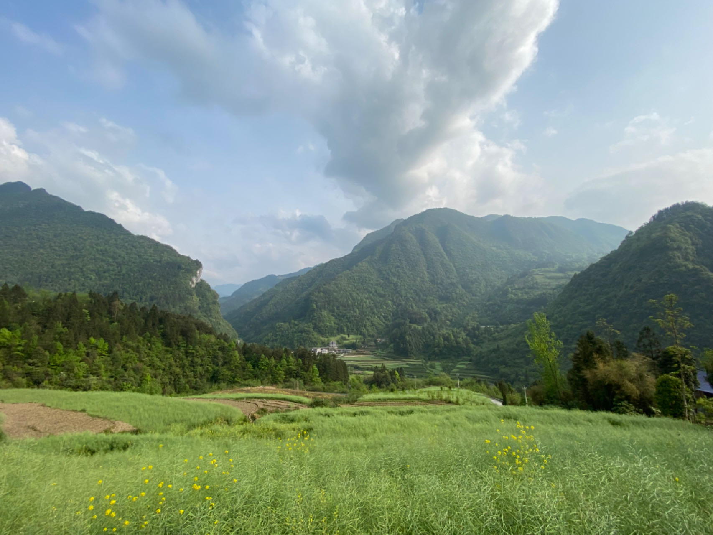

#### \_园\_

在湖北恩施乡村的一所图书馆里，我度过了人生中最为平静而快乐的十五天。那段时间，除了导员偶尔的催促，就没有什么值得焦虑的事了。日子像溪水一样缓慢地流淌，悄无声息。

在那个被群山环抱的小村庄，我获得了有史以来最为安稳的睡眠。当朝阳透过图书馆木质的窗框洒落在书页和木桌上，尘埃在光里悄然起舞，那一刻连时间都变得轻缓。

如今，那些朋友早已天各一方，世界真的很大，如果没有刻意的见面，就真的没有再见过了。有些人我们已经见过这辈子最后一面了。外面短暂的相遇，却久久不能忘怀——因为那是某种更接近本真的生活方式，一种在浮躁与焦虑之外，人与人、人与自然之间难得的、柔和的连接。

那段时间之后，我渐渐意识到，真正令人怀念的，不只是图书馆里的阳光、山谷间的云雾，或是朋友们的欢笑声，而是那种被安静包裹着的心情——一种不必赶路、不用比较、不需证明自己的状态。那是一种久违的自由，是心灵的松弛，是我在漫长岁月奔波中，难得拾起的宁静。这些画面好像只存在于记忆中，于现实中并没有发生。

有很多人奔劳一生都没有抬头看看天上的星星，而我痴迷于星空却忘记了前行。我总是活在未来或过去，却从未活在现在。

